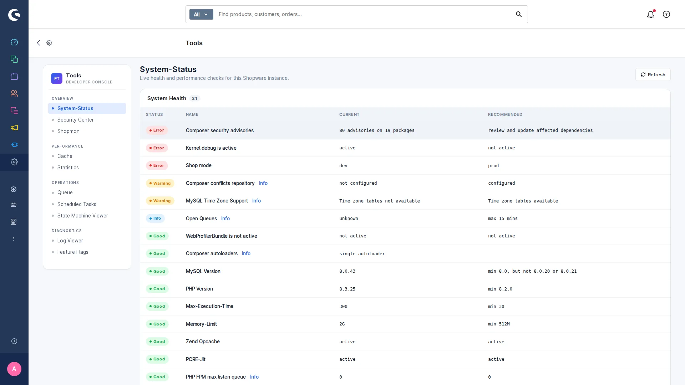
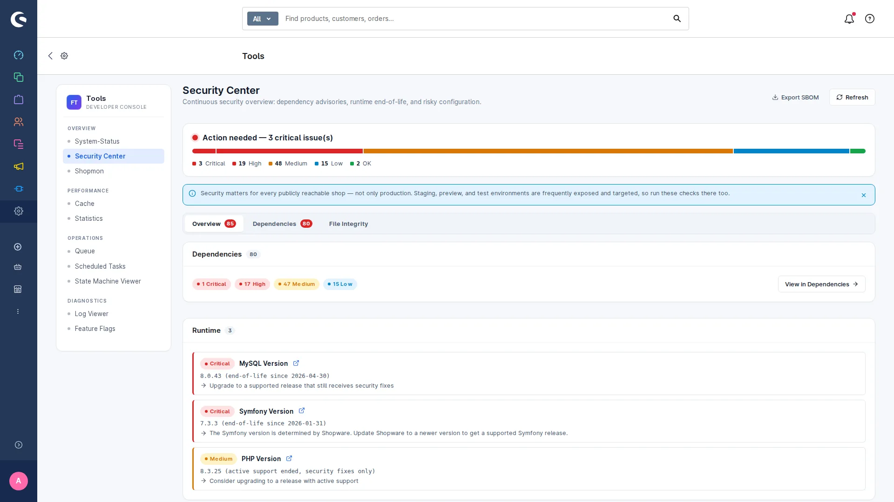
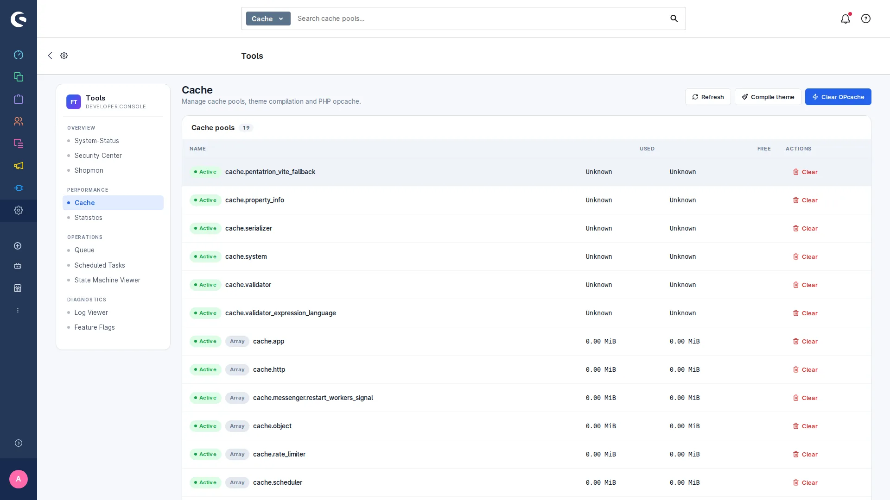
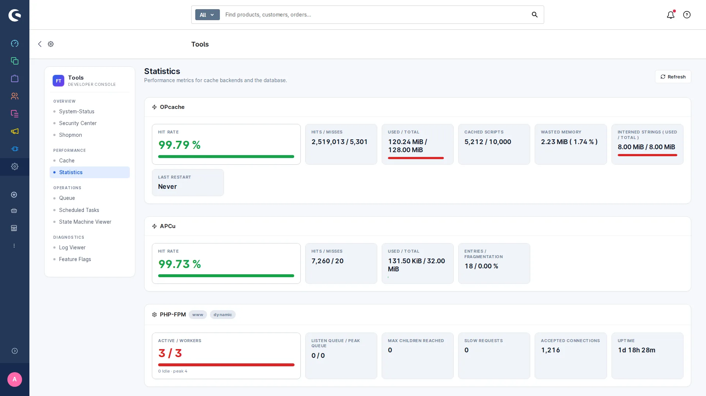
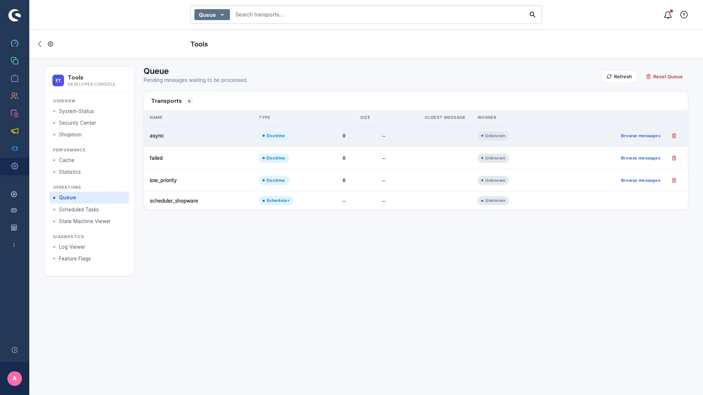
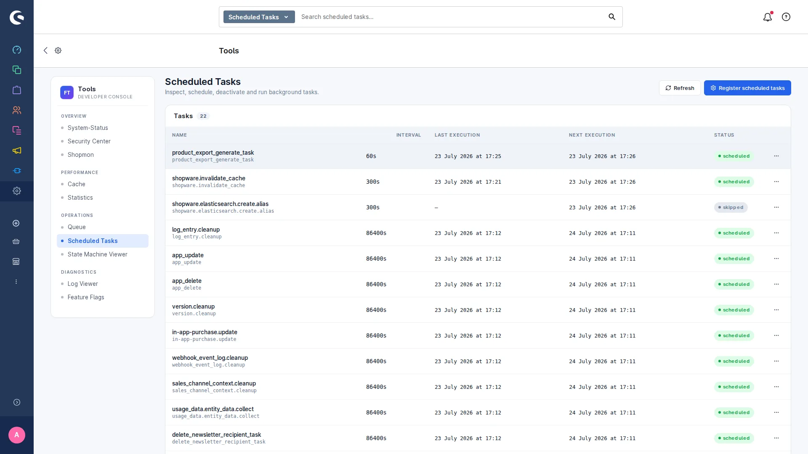
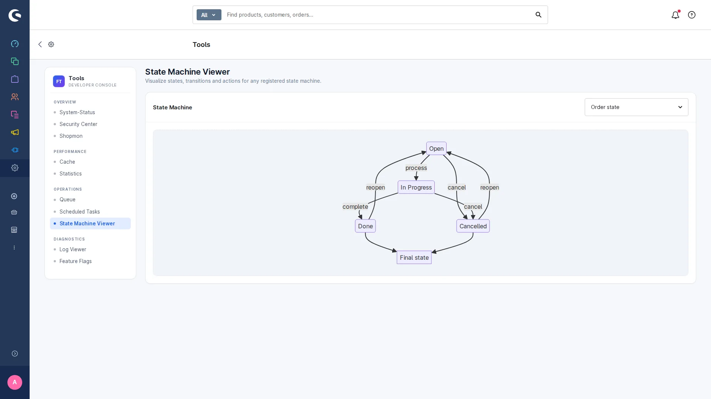
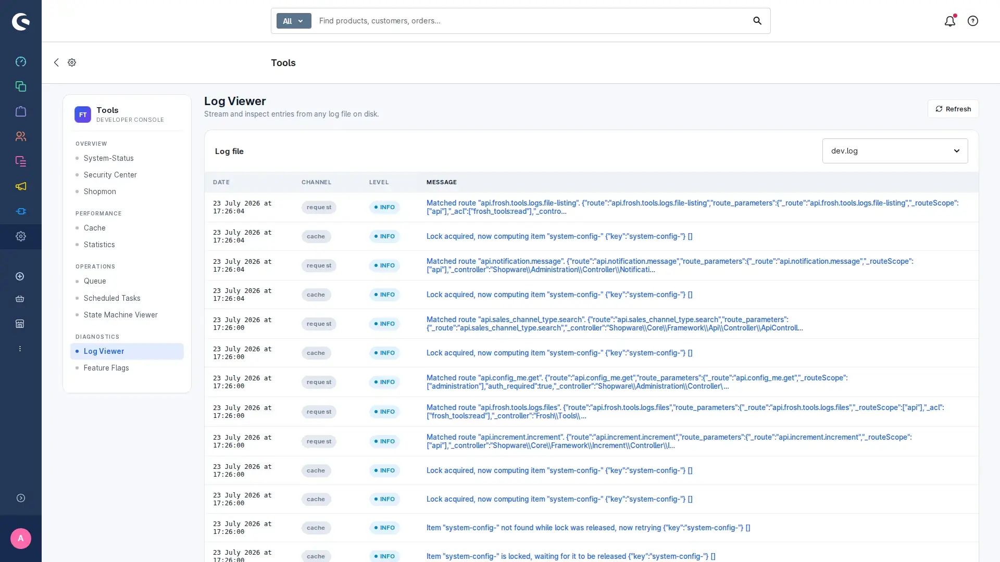
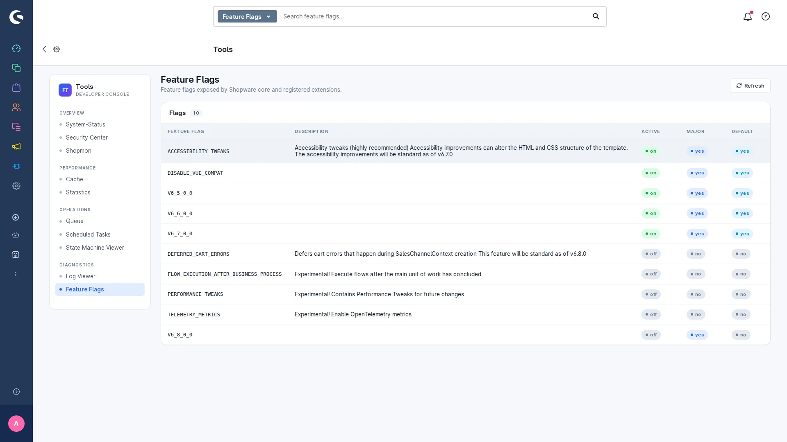
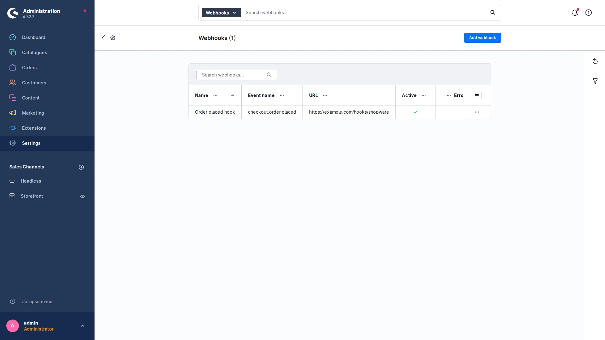

# Frosh Tools

[](LICENSE.md)
[](https://www.shopware.com/)
[](https://packagist.org/packages/frosh/tools)

**Operator toolkit for Shopware 6** — health checks, cache & queue ops, security audits, logs, Elasticsearch tooling, and more, directly in the Administration.

Maintained by [FriendsOfShopware](https://friendsofshopware.com).  
Repository: [github.com/FriendsOfShopware/FroshTools](https://github.com/FriendsOfShopware/FroshTools)

---

## Why Frosh Tools?

Shopware shops accumulate operational work that usually needs SSH, Redis CLIs, Elasticsearch dashboards, or ad-hoc scripts. Frosh Tools brings those day-to-day tasks into the Admin under **Settings → Plugins → Tools**, so merchants and developers can inspect and act without leaving the browser.

| For operators | For developers |
| --- | --- |
| Clear caches & compile themes | System health + performance recommendations |
| Inspect queues and scheduled tasks | Feature flags, state machines, webhooks |
| Read production logs | Elasticsearch console & index lifecycle |
| Security overview + SBOM export | File integrity for core and extensions |
| Monitor tasks/queues via CLI mail alerts | Redis namespace/tag cleanup helpers |

Compatible with **Shopware 6.6 and 6.7**.

---

## Screenshots

### System Status

Live health checks (PHP, MySQL, queue, tasks, …) plus performance recommendations with documentation-oriented guidance.



### Security Center

Dependency advisories, runtime end-of-life checks, configuration risks, file integrity — and **Export SBOM** (CycloneDX 1.7 from `composer.lock`).



### Cache Manager

List cache pools, clear individual pools, compile the theme, and clear PHP OPcache.



### Statistics

OPcache hit rate/memory, cache backend metrics, and database server statistics.



### Queue Manager

Transport overview (Doctrine, Redis, AMQP, …), message sizes, worker heartbeat, browse/retry/delete messages, purge or reset.



### Scheduled Tasks

Inspect all tasks, edit interval & next run, run a single task, register missing tasks.



### State Machine Viewer

Interactive diagrams for order, payment, delivery, and other registered state machines.



### Log Viewer

Browse any file under `var/log/` from the Admin.



### Feature Flags

List core and extension feature flags; toggle where supported.



### Webhooks

Dedicated list/detail UI for Shopware webhooks (including inline search).



---

## Features

### Administration — Tools module

| Area | Capabilities |
| --- | --- |
| **System Status** | Health checkers (PHP/FPM, MySQL, queue lag, scheduled tasks, composer audit summary, debug/prod mode, …) and a large set of **performance recommendations** (admin worker, mail-over-queue, increment storage, OPcache flags, ES, product-stream indexing, …). |
| **Security Center** | Severity overview; Packagist dependency advisories; PHP / MySQL / Symfony / Shopware EOL; environment risks; **core & extension file integrity**; **CycloneDX 1.7 SBOM export**. |
| **Cache** | Pool listing with clear actions, theme compile, OPcache clear. |
| **Statistics** | OPcache, cache-adapter, and database metrics for capacity troubleshooting. |
| **Queue** | Multi-transport support (Doctrine, Redis, AMQP, fallback); browse without consuming (or fetch+requeue); retry failed messages; purge transport; reset queue. |
| **Scheduled Tasks** | List, run, deactivate; edit interval & next execution; register tasks. |
| **State Machines** | Diagram viewer for any registered state machine. |
| **Log Viewer** | Read `var/log/*.log` in the browser. |
| **Feature Flags** | Inspect and toggle flags from core/plugins. |
| **Elasticsearch** | Status, indices, reindex, alias switch, unused/orphaned cleanup, console. Optional `show_all_indices`. |
| **Fastly** | Purge all / by URL and basic stats when Fastly is configured. |
| **Shopmon** | Optional integration setup for external Shopmon monitoring. |
| **Apps** | External reachability of APP_URL checked by the Cloudflare Worker, Shopware account login status, current Shop App ID with password-confirmed reveal/copy, installed app list, and password-confirmed reset of the Shop App ID with uninstall of all apps. |
| **Webhooks** | Separate Admin module to create, search, and manage webhooks. |

The Apps reachability check uses the public [Cloudflare Worker](workers/app-url-reachability/README.md) at `https://app-url-check.fos.gg`. The Worker calls the FroshTools probe on APP_URL and verifies a fresh challenge response.

### Status badge in the Admin sidebar

On Shopware 6.6 / 6.7.13 the existing `sw-version` layout and health status dot are preserved. On Shopware 6.7.15 / trunk, warning or critical health replaces the sidebar **Administration** title with a badge that links to Tools, with the Shopware version beside it. The badge stays inside the header `mt-text` so the 40px row is not stretched. When healthy, the Administration title remains visible with a green status dot that links to Tools.

### Console commands

| Command | Purpose |
| --- | --- |
| `frosh:dev:robots-txt` | Block crawlers on test shops (`-r` to revert) |
| `frosh:composer-plugin:update` | Update Composer-managed plugins |
| `frosh:monitor <sales-channel-id>` | Email alert when queues/tasks exceed grace times |
| `frosh:es:delete-unused-indices` | Delete unused Elasticsearch indices |
| `frosh:extension:checksum:check [name]` | Verify extension file integrity |
| `frosh:extension:checksum:create [name]` | Create extension checksum manifests |
| `frosh:redis-namespace:list` | List Redis namespaces *(experimental)* |
| `frosh:redis-namespace:cleanup` | Clean Redis namespaces (`--dry-run` supported) *(experimental)* |
| `frosh:redis-tag:cleanup` | Clean Redis tags |
| `frosh:twig:warmup` | Warm Twig template cache |
| `frosh-tools:health-check-json` | Print merged health-check results as JSON (CI / monitoring) |
| `frosh:telemetry [--send]` | Preview the anonymous telemetry payload, or send it now (opt-in required) |

---

## Requirements

- Shopware **6.6** or **6.7**
- PHP version required by your Shopware minor
- Admin ACL privileges under **Settings → Users & permissions** (Viewer / Editor per area):
  - **Frosh Tools** — system status, statistics, feature flags, state machines. Editor grants every Tools write privilege (and pulls in the other viewers).
  - **Cache / Queue / Scheduled tasks / Search indices / Security / Fastly / Shopmon / Apps / Telemetry** — Viewer to open the tab, Editor for mutations (clear cache, retry/purge, run tasks, reindex, restore files, purge CDN, setup integration, reset Shop App ID, change the telemetry opt-in).
  - **Logs** — Viewer only (production log contents).
  - Webhook privileges remain a separate CRUD row.

  Existing roles that only had `frosh_tools:read` keep the overview tabs; re-open the role and tick the area viewers/editors they should keep. Super-admin is unchanged.

---

## Installation

### Composer (recommended)

```bash
composer require frosh/tools
bin/console plugin:refresh
bin/console plugin:install --activate FroshTools
bin/console cache:clear
```

### Shopware Store package

```bash
composer require store.shopware.com/froshtools
bin/console plugin:refresh
bin/console plugin:install --activate FroshTools
bin/console cache:clear
```

> Store installs need a valid `packages.shopware.com` Composer auth token.

### From Git (development)

```bash
git clone https://github.com/FriendsOfShopware/FroshTools.git custom/plugins/FroshTools
shopware-cli extension prepare custom/plugins/FroshTools
shopware-cli extension build custom/plugins/FroshTools
bin/console plugin:refresh
bin/console plugin:install --activate FroshTools
bin/console cache:clear
```

After activation, open **Settings → Plugins → Tools** (or search for “Tools” in the Admin).

---

## Configuration

Optional Symfony config — create `config/packages/frosh_tools.yaml`:

```yaml
frosh_tools:
    # Skip specific health/performance checkers by id (when needed)
    checker:
        disabled_checks: []

    # Paths that File Checker should not offer to restore
    file_checker:
        exclude_files:
            - vendor/shopware/core/FirstFile.php
            - vendor/shopware/core/SecondFile.php

    # Elasticsearch manager: list every index instead of only Shopware prefixes
    elasticsearch:
        show_all_indices: false

    # Administration "forgot password" flow (backport of shopware.api.user_recovery.enabled).
    # It is generally recommended to disable it and reset passwords via
    # "bin/console user:change-password" when needed. Also useful when passwords
    # are managed externally, e.g. via SSO.
    user_recovery:
        enabled: true
```

Plugin system config (Admin → Extensions → Frosh Tools):

- **Monitor mail address** — recipient for `frosh:monitor`
- **Default queue grace time** (minutes) — when a pending message is considered stuck
- **Exclude failed queues** — ignore transports whose name contains `failed` (default on)
- **Queues to monitor** — optional allowlist, e.g. `async, low_priority`
- **Per-queue grace times** — optional overrides, e.g. `async:15, low_priority:60`
- **Task grace time** (minutes) — when a scheduled task is considered stuck
- **Share anonymous usage telemetry** — daily opt-in event to PostHog EU (default off, see below)

JSON Schema for IDE validation: [`frosh-tools-schema.json`](frosh-tools-schema.json).

### Anonymous telemetry

Frosh Tools can send **one anonymous event per day** to [PostHog EU](https://eu.posthog.com) (`eu.i.posthog.com`) to help the Friends of Shopware team see which Shopware/PHP/database versions and setups are actually in use. The collected data is **available for anyone to see** on the [public dashboard](https://eu.posthog.com/shared/iY7ArzsigzNyWEnm0kAGBQaEib9qxQ) and allows Shopware and extension developers to improve their extensions and focus on the most important things. It is **opt-in and off by default**: nothing is sent until **Share anonymous usage telemetry** is enabled in the plugin configuration. Sending happens in the scheduled task `frosh_tools.telemetry` (daily interval); the task is a no-op while opt-in is off.

The Administration has a dedicated **Tools → Telemetry** page (privileges: **Frosh Tools — Telemetry** Viewer/Editor) that explains why the data is collected, contains the same opt-in switch, shows the destination/event/installation ID and the **exact payload that would be sent right now** as a property/value table (with copy-as-JSON). From there you can also send once immediately (still requires the opt-in) or reset the anonymous installation ID.

The event (`frosh_tools_telemetry`, `schema_version: "2"`) contains exactly these properties:

| Property | Meaning |
| --- | --- |
| `collected_at` | Collection time (ISO 8601, UTC) |
| `shopware.version`, `shopware.version_major_minor` | Shopware version, full and reduced to major.minor |
| `symfony.version_major_minor` | Symfony version reduced to major.minor |
| `frosh_tools.version`, `frosh_tools.version_major_minor`, `frosh_tools.managed_by_composer` | Frosh Tools version and whether it is installed via Composer (vs. Store/zip) |
| `shopware.runtime_extension_management` | Whether extensions can be managed at runtime (Admin/Store) or the deployment is Composer-managed |
| `app.prod`, `app.debug` | Whether the kernel runs in the `prod` environment / with debug mode — booleans only, never the (possibly custom) environment name |
| `php.version_major_minor`, `php.apcu_enabled`, `php.opcache_enabled` | PHP version (major.minor) and whether APCu / OPcache are enabled for PHP |
| `php.redis_enabled`, `php.amqp_enabled`, `php.intl_enabled`, `php.imagick_enabled`, `php.gd_enabled` | Whether the PHP extensions redis / amqp / intl / imagick / gd are loaded |
| `php.xdebug_enabled`, `php.ioncube_enabled` | Whether Xdebug (mode not `off`) / ionCube Loader are loaded |
| `php.tideways_enabled`, `php.blackfire_enabled`, `php.newrelic_enabled` | Whether an APM/profiling agent (Tideways, Blackfire, New Relic) is loaded |
| `cache.apcu_enabled`, `cache.opcache_enabled`, `cache.redis_enabled` | Whether any Symfony cache pool uses APCu, OPcache (PhpFiles) or Redis |
| `database.type`, `database.version_major_minor` | `mysql` or `mariadb`, version reduced to major.minor |
| `queue.transports` | Messenger transport **types** only, e.g. `doctrine,redis` — never queue names |
| `admin_worker.enabled` | Whether the Admin Worker is enabled |
| `http_cache.reverse_proxy_enabled`, `http_cache.type` | HTTP cache setup: `builtin`, `varnish` or `fastly` |
| `session.handler` | Session storage type: `file`, `redis`, `memcached`, `database`, `mongodb`, `null`, `other` or `unknown` |
| `increment.user_activity`, `increment.message_queue` | Increment storage types: `mysql`, `redis`, `array` or `other` |
| `storage.media_type` | Media filesystem type: `local`, `amazon-s3`, `google-storage` or `other` — never bucket names or credentials |
| `mail.transport`, `mail.queue_enabled` | Mail transport scheme only (`smtp`, `sendmail`, `null`, known provider schemes, else `other`/`unknown`) and whether mails are sent over the queue. The Admin mailer config wins over `MAILER_DSN`, like in Shopware itself; hosts/credentials are never sent |
| `search.enabled`, `search.engine` | Search engine: `elasticsearch`, `opensearch` or `database` |
| `search.version_major_minor`, `search.indices` | Search cluster version (major.minor) and Shopware index count as a range bucket — only when search is enabled |
| `shop.extensions_total`, `shop.extensions_active` | Number of installed / active plugins |
| `shop.apps_total`, `shop.apps_active` | Number of installed / active apps |
| `shop.products`, `shop.orders`, `shop.customers` | Shop size as a **range bucket** (`0`, `1-10`, `11-100`, `101-1000`, `1001-10000`, `10001-100000`, `100001+`) — never exact counts |

Privacy properties:

- **No identifying data** — no shop URL, host name, shop name, sales channel, customer/order/product data, or extension names.
- The `distinct_id` is a **random UUID** generated once per installation (stored as `FroshTools.config.telemetryInstanceId`) so active installations can be counted over time. It cannot be linked to a shop. Delete that config value to rotate it.
- Events are sent with `$process_person_profile: false` (no person profiles are created in PostHog) and `$geoip_disable: true` (PostHog does not derive location data from the request IP).
- Preview the exact payload any time on the **Tools → Telemetry** admin page or with `bin/console frosh:telemetry` (add `--send` to send immediately; still requires the opt-in). Viewing the preview creates no installation ID and sends nothing. The implementation lives in `src/Components/Telemetry/`.

---

## Monitoring & CI hooks

```bash
# Human-oriented mail alert (cron)
bin/console frosh:monitor <sales-channel-id>

# Machine-readable health snapshot
bin/console frosh-tools:health-check-json
```

Wire the JSON command into uptime checks, deploy gates, or external monitors. The Security Center **Export SBOM** action produces a CycloneDX 1.7 document suitable for dependency scanners.

---

## Development

```bash
# Format / static checks via shopware-cli (Docker)
composer format
composer check

# PHPUnit (from a Shopware project that requires this plugin)
composer phpunit

# Administration unit tests (Shopware 6.6, 6.7, and trunk)
# Requires the Administration source + its node_modules; see
# https://github.com/FriendsOfShopware/vitest-shopware-admin-bridge
cd src/Resources/app/administration
npm ci
npm run test:unit:doctor
npm run test:unit
```

Admin sources live under `src/Resources/app/administration`. Rebuild with:

```bash
shopware-cli extension build custom/plugins/FroshTools
# or, from the Shopware root:
bin/build-administration.sh
```

---

## Links

- [GitHub Issues](https://github.com/FriendsOfShopware/FroshTools/issues) — bugs & feature requests  
- [FriendsOfShopware](https://friendsofshopware.com)  
- [Shopware Store listing](https://store.shopware.com/) (search “Frosh Tools”)  
- Maintainer: [Soner Sayakci (@shyim)](https://github.com/shyim)

---

## License

[MIT](LICENSE.md)
